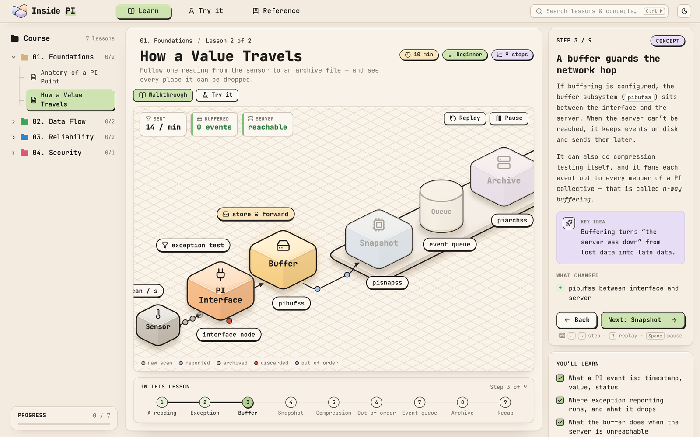

# Inside PI

An interactive, isometric course on the **AVEVA PI System**, starting with PI Data Archive and growing toward everything in PI (see the [roadmap](curriculum/ROADMAP.md)). Each idea is an animated diagram you step through, from what a PI point is to how a value travels from a sensor into an archive file.

**Live site:** https://nurnaufal321.github.io/inside-pi/



## The course

Ten lessons in five chapters so far:

| Chapter | Lesson | Steps |
|---|---|---|
| 01. Foundations | Anatomy of a PI Point | 9 |
| | How a Value Travels | 9 |
| 02. Data Flow | Exception & Compression | 10 |
| | Snapshot & Event Queue | 9 |
| 03. Reliability | Buffering | 9 |
| | Archive Lifecycle | 9 |
| 04. Security | Who Gets In | 10 |
| 05. Asset Framework | Elements & Templates | 10 |
| | Attributes & Data References | 10 |
| | Event Frames | 10 |

Every lesson has:

- **A walkthrough.** An isometric scene that pans and zooms to the part each step explains, with animated events flowing between subsystems.
- **A step rail.** The narrative, a key-idea or watch-out callout, what changed since the last step, and a "You'll learn" checklist.
- **Try it.** A live simulation you can drive with sliders and toggles, such as the swinging-door compression chart or the buffer queues.
- **Docs links.** Every claim and link is checked against the official docs at [docs.aveva.com](https://docs.aveva.com/category/pi-system). The **Reference** page lists all sources by lesson.

The app also has keyboard shortcuts (`←` `→` to step, `R` to replay, `Space` to pause), progress saved in the browser, search (`Ctrl K`), a dark theme and a phone layout.

## Run it locally

You need Node 22.

```bash
cd module-3-4-exception-compression
npm ci
npm run dev      # then open http://localhost:5173/inside-pi/
npm run build    # type-check and build to dist/
```

## Project layout

```
.github/workflows/deploy.yml     build and publish to GitHub Pages
curriculum/                      the original curriculum outline
module-3-4-exception-compression/
  src/lessons/                   one file per lesson, plus index.ts (chapters and lesson order)
  src/components/iso/            the isometric kit: Block, Slab, Cylinder, Crowd, Pill, Gauge, Link, Flow, Stage
  src/components/shell/          top bar, course tree, lesson view, step rail, routing
  src/components/module*/        Try it simulations (ModuleCanvas.tsx and sim/ for exception & compression)
  src/index.css                  design tokens (light and dark) and layout
```

## Adding a lesson

The full pipeline is written up as a Claude Code skill in [`.claude/skills/inside-pi-lesson/SKILL.md`](.claude/skills/inside-pi-lesson/SKILL.md): research with the PI docs MCP, outline, scaffold, build, verify, ship. [`curriculum/ROADMAP.md`](curriculum/ROADMAP.md) lists every planned chapter.

By hand:

```bash
cd module-3-4-exception-compression
npm run new-lesson -- <chapter-id> <lesson-id> "<Lesson title>" "<Chapter title>"
# fill in the TODOs in src/lessons/<id>.tsx and src/components/tryit/<id>.tsx
npm run check    # content rules: camera, learn, recap, docs URLs, no TODOs
npm run build
```

[`docs/iso-kit.md`](docs/iso-kit.md) lists the primitives, the layout rules and the Try-it kit.

## Deploy

Every push to `main` or `claude/aveva-pi-archive-curriculum-8fx6sb` runs `.github/workflows/deploy.yml`, which builds the app and publishes it to GitHub Pages under `/inside-pi/`.

## Credits

- The visual style is inspired by Dilum Sanjaya's [*designed-to-scale*](https://designed-to-scale.vercel.app/) system design course. It was rebuilt from scratch here; no code was copied.
- Icons: [Lucide](https://lucide.dev) (ISC). Font: [JetBrains Mono](https://www.jetbrains.com/lp/mono/) (OFL).
- AVEVA and PI System are trademarks of AVEVA Group. This is an independent learning project, not an official AVEVA product.
